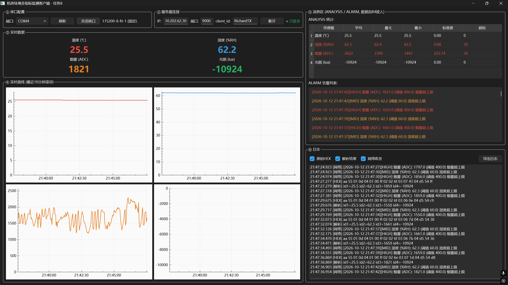
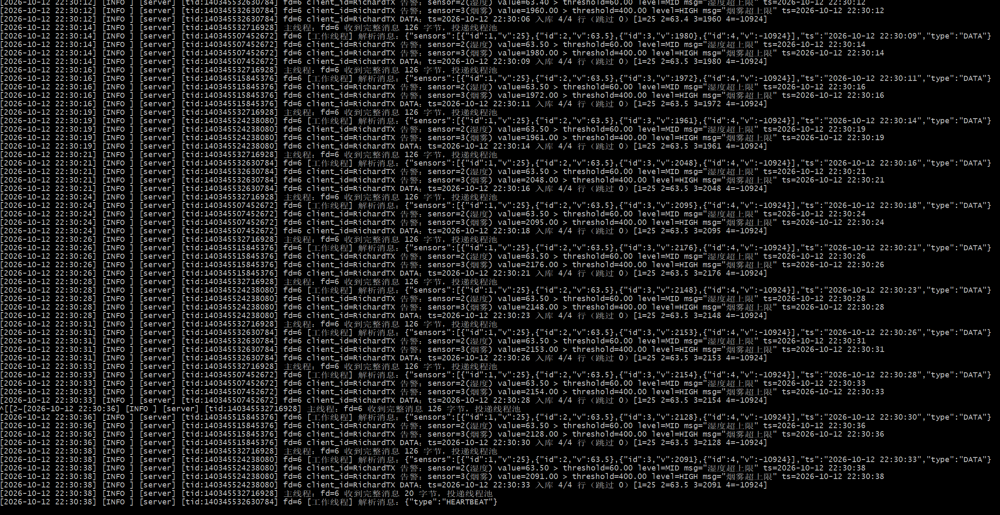

# 机房环境多指标远程监测与分析系统

通信系统综合设计（DX702006）· 2026.9.21 – 10.13

## 系统链路

DHT11/MQ-2/BH1750 → STM32F103C8T6 (UART帧协议) → USB转TTL → Qt客户端(串口+TCP) → VMware Ubuntu服务器(select+多线程+MySQL) → 统计分析/告警回传

## 效果预览

| 客户端（实时曲线 + 告警/统计） | 服务器（多客户端接入 + 入库） |
|---|---|
|  |  |

原理图与实物照片见 [`docs/图片/`](docs/图片/)。

## 文档导航

| 文档 | 用途 |
|---|---|
| `docs/接口规范.md` | **三端契约（必读）**：串口帧协议+TCP JSON协议+数据库，含冻结的测试向量 |
| `docs/系统设计方案.md` | 总体设计：架构、选型、计划（报告底稿） |
| `docs/单片机端.md` | 开发文档：分步任务+验收标准+参考链接 |
| `docs/客户端.md` | 开发文档：同上 |
| `docs/服务器端.md` | 开发文档：同上 |
| `docs/服务器端-调试记录.md` | 服务器端调试全过程记录（问题清单与定位） |
| `docs/虚拟机固定IP操作指南.md` | 服务器虚拟机固定 IP 设置步骤 |

> Agent 工具接手时：**第一步读接口规范，第二步读对应的开发文档**，接口字段不得擅改。

## 目录结构

```
machine-room-monitor/
├── docs/                 文档（见上表）+ 报告用图片（docs/图片/）
├── stm32-firmware/       单片机端：Keil工程 + 源码 + 标准库 + 接线表
├── hardware/             单片机端：原理图（Proteus/KiCad 双版本 + 生成脚本）
├── client-qt/            客户端：Qt源码 + 使用说明 + 验收证据/
├── server-linux/         服务器端：源码 + Makefile + sql/init.sql + 运行说明.md
└── simulator/            共享联调工具（见下）
```

> 仓库只收录源码与验收证据；编译产物与发布包（对象文件、hex/exe、
> Qt 运行库、打包 zip）不入库，自行构建见下一节。
> `client-qt/验收证据/` 为客户端 8 项验收数据与 7 份联试日志，
> 与 `client-qt/客户端资产清单.md` 一一对应。

## 自己编译 / 打包

### 单片机端（Keil MDK）

打开 `stm32-firmware/MDK-ARM/machine-room-monitor.uvprojx` 编译，
hex 生成在 `MDK-ARM/Objects/`；接线与烧录见 `stm32-firmware/接线表.md`。

### 客户端（Qt 6 + MinGW）

```bash
cd client-qt
qmake client-gui.pro
mingw32-make release
windeployqt release/client.exe      # 部署 Qt 运行库到 release/
```

把 `release/` 整个目录拷给使用者即可运行（exe + 全部 DLL），
运行说明见 `client-qt/使用说明.txt`。

想打包成**免安装单文件版**（WinRAR 自解压包）时，先造一个配置文件 `sfx_config.txt`：

```
Setup=client.exe
TempMode
Silent=1
Overwrite=1
```

再执行（注意在部署目录内打包，压缩包根层就是 `client.exe`）：

```bash
cd client-qt/机房环境监测客户端
"C:/Program Files/WinRAR/Rar.exe" a -r -sfx -z../sfx_config.txt \
    "../机房环境监测客户端-单文件版.exe" "*"
```

### 服务器（Ubuntu）

见 `server-linux/运行说明.md`（依赖安装、建库、编译、运行与联调步骤）。

### 硬件原理图

见 [`hardware/README.md`](hardware/README.md)（Proteus/KiCad 打开方式 + 重新生成脚本）。

## 联调工具（simulator/）

```bash
# 串口模拟器（模拟STM32发帧，给客户端B联调用；需 pip install pyserial）
python simulator/stm32_sim.py -p COM4                # 随机游走数据，2秒一帧
python simulator/stm32_sim.py -p COM4 --vector v1    # 发送接口规范测试向量V1
python simulator/stm32_sim.py -p COM4 --corrupt      # 注入错误帧测客户端容错

# TCP探测工具（纯标准库）
python simulator/server_probe.py server -p 9000                  # 假服务器（测客户端）
python simulator/server_probe.py client -H <IP> --id PC-01       # 假客户端（测服务器）

# 向量自校验（开发前先跑，确认工具本身正确）
python simulator/verify_vectors.py
```

## 关键配置速查

- 串口：115200-8-N-1，帧协议见接口规范§2
- 服务器：TCP 9000（VMware 桥接）
- MySQL：库 machine_room，用户 iot/iot123456，脚本 server-linux/sql/init.sql
- 阈值：温度 18~26℃ / 湿度 40~60% / 烟雾 ADC>400 / 光照仅记录
- 联调环境：com0com 虚拟串口对（COM3↔COM4）

## 实施顺序建议

1. 按开发文档推进各模块（客户端/服务器用 simulator 自测）
2. 客户端↔服务器先行拼合，跑通 JSON 链路
3. 单片机真机接入替换模拟器
4. 按接口规范§6联调清单验收 → 报告
